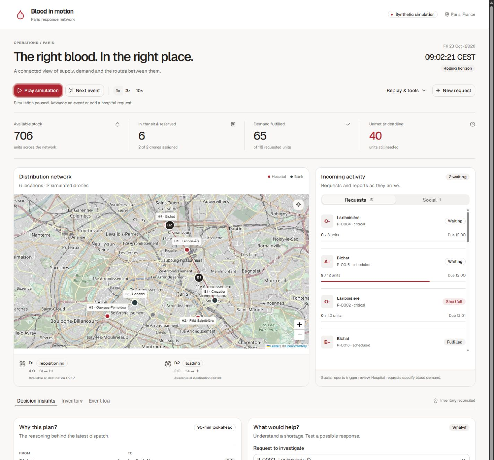
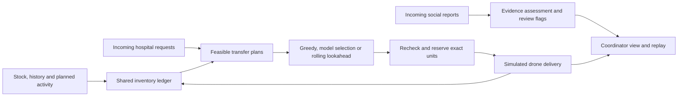

# Blood in Motion

**A blood-logistics simulator for Paris, where incoming requests change the plan.**

Built for **Accel AI Innovate: Paris**, for the *Future Founders: Data-Centric Agents* challenge. Completed hackathon prototype, preserved as a working demo and technical case study.

[Run the demo](#run-the-demo) · [How it works](#how-it-works) · [Results](#what-we-measured) · [Documentation](#explore-the-project)



*An interactive synthetic scenario. The screenshot includes a manually injected shortage test; it is not the benchmark run.*

## The idea

A hospital needs blood. Another location has it. Can the network get the right units there before the deadline, without promising the same stock twice or leaving the donor site below its reserve?

Blood in Motion puts that question on a map. Four hospitals, two blood banks and two simulated drones respond to hospital requests, scheduled activity, stock changes and a stream of social reports. A coordinator can follow each reservation and delivery, inspect why a plan was selected, and test what would help when a request cannot be met.

The interesting part is the boundary between uncertain evidence and executable decisions. A social report can trigger review. A hospital request specifies blood demand. Code defines the feasible transfers; an optional model controller chooses between those plans. A separate rolling-horizon scheduler explores the consequences of acting now.

## Try it

- **Watch the network:** play the weekend or advance one event at a time.
- **Create demand:** send an eight-unit O-negative request to Lariboisière and follow the drones.
- **Inspect the decision:** compare the chosen continuation with the greedy baseline in **Why this plan?**
- **Investigate a shortage:** use **What would help?** to compare extra fleet capacity with usable stock at the requesting hospital.
- **Replay the evidence:** save a run and inspect its timeline without making new API calls.

## Run the demo

Python 3.12+ is recommended. The compiled React interface is included; Node.js is only needed to edit it.

```sh
git clone https://github.com/benlewis-beyondthought/blood-in-motion.git
cd blood-in-motion
python -m pip install -r requirements.txt
python -m blood_response.dispatch_server --scheduler rolling --port 8878 --output runs/first-demo
```

Open **http://127.0.0.1:8878/**. This mode uses deterministic scheduling and requires no API key. Use a new output directory for each server invocation. The simulation runs locally; the OpenStreetMap background tiles need internet access.

To let the Decisions API choose between feasible individual transfers:

```sh
python -m blood_response.dispatch_server --scheduler greedy --controller decisions --prompt-key --output runs/model-demo
```

The hidden prompt keeps the key out of browser code and shell history. Live calls require access to the API and model configured in the adapter and can incur charges. The recorded results below remain available independently of current API access.

| Mode | Transfer selection | Social reports |
|---|---|---|
| `--scheduler rolling` | Bounded 90-minute lookahead | Deterministic review policy |
| `--scheduler greedy` | Priority and deadline heuristic | Deterministic review policy |
| `--scheduler greedy --controller decisions` | Model chooses from code-validated plans | Model classification plus application policy |
| `--scheduler rolling --controller decisions` | Deterministic lookahead | Model classification plus application policy |

[Full walkthrough and assumptions](docs/DRONE-DEMO.md) · [Frontend development](docs/INTERFACE.md)

## How it works



**Data comes first.** The active source bundle contains 1,538 units, including 777 available units, 981 completed historical transfers and 247 planned procedures. Normalization reconciles usage with consumed units and movement histories with unit locations. An older, conflicting inventory is preserved separately and excluded from active stock.

**Execution stays constrained.** A transfer must pass stock, blood-group, expiry, reserve, route, drone-capacity and deadline checks. Reservation uses exact unit IDs. Every operational event checks the ledger. Unsupported external routes cannot produce new deliveries.

**Planning sees only available information.** The rolling scheduler tests a bounded set of first actions, simulates 90-minute continuations, commits one action and replans. It sees published planned activity, but not future scripted emergencies or social posts. What-if experiments run on isolated copies and do not change live stock.

**Social evidence is separate from demand.** Reports can be uncertain, duplicated, corrected or outside Paris. Their flags support investigation. The system does not convert protest intensity or social popularity into transfusion units.

## What we measured

One authored weekend scenario, with the same initial eight-unit manual request: **469 units requested**.

| Recorded controller | Units delivered by deadline | Units unmet | Completed missions | Successful API calls |
|---|---:|---:|---:|---:|
| Greedy baseline | 392 | 77 | 76 | 0 |
| Decisions API transfer controller | 392 | 77 | 76 | 98 |
| Rolling-horizon scheduler | 398 | 71 | 76 | 0 |

The live API run made **65 transfer choices and 33 social assessments**. Eleven transfers had only one feasible plan and executed directly. All selected transfers belonged to the offered feasible set. The model matched the greedy baseline's aggregate delivery outcome; this run did not demonstrate model superiority.

Rolling lookahead delivered **six additional routine units**. Critical unmet demand stayed at 47 units, and the number of requests with some shortfall rose from 14 to 15. This exposes a real trade-off in the objective: maximizing units delivered does not necessarily maximize fully satisfied requests. The rolling comparison did not rerun the model.

[Live-run evidence](docs/DRONE-VERIFICATION.md) · [Scheduler comparison](docs/ROLLING-SCHEDULER.md) · [Machine-readable summaries](docs/evidence/README.md)

The earlier social-only experiment is also preserved: 36 synthetic reports, 108 API calls and 32/36 agreement with the authored report-action labels. Those labels were not independently reviewed; agreement is not clinical accuracy. [Original findings](openai-decisions-replay-v1/FINDINGS.md)

## Scope and lessons

This is a **completed synthetic hackathon project**, not a clinical dispatch service. Facility names and map locations provide context; stock, demand, operational rules and drone performance are demo assumptions. There are no patient identities, live hospital feeds, validated clinical allocation rules or real drone operations. The social scenario is not a reconstruction of verified casualties or blood shortages.

The challenge asked for agents grounded in changing data, a complete user journey and evidence against a baseline. This prototype explores that through a reconciled inventory, event-driven decisions, explicit feasibility checks and inspectable replays. The brief also encouraged Aiven deployment; this repository documents a local implementation and an optional PostgreSQL adapter, not a verified Aiven deployment.

The main lesson: use models where interpretation or selection is useful, make the executable boundary explicit, and measure the whole system against a simple baseline.

## Verify or extend it

```sh
python -m blood_response validate
python -m unittest discover -s tests -v
python tools/compare_schedulers.py --output runs/my-comparison
```

Validation checks the canonical ledger and original-source hashes. Regression tests cover reservations, deadlines, future-event isolation, API fallbacks, what-if isolation and the full synthetic flow. The paired comparison can take a few minutes.

To edit the UI, use Node.js 24:

```sh
cd frontend
npm ci
npm run build
```

The build writes into `blood_response/web/`, which the Python server serves directly. GitHub Actions runs frontend compilation, data reconciliation, regression tests and the paired scheduler comparison.

## Explore the project

| Path | What is there |
|---|---|
| [`blood_response/`](blood_response/) | Simulation engine, shared ledger, schedulers, API adapter and local server |
| [`frontend/`](frontend/) | React, TypeScript, shadcn/ui and Leaflet interface |
| [`data/canonical/`](data/canonical/) | Shared data contract and forward scenario |
| [`data/raw/`](data/raw/) | Original contributor files, preserved byte-for-byte |
| [`tests/`](tests/) | Integration, dispatch and planning regression tests |
| [`docs/INTEGRATION.md`](docs/INTEGRATION.md) | Data provenance, reconciliation and explicit gaps |
| [`docs/ROLLING-SCHEDULER.md`](docs/ROLLING-SCHEDULER.md) | Planning objective, diagnostics and counterfactuals |
| [`paris-protest-social-simulation-v1/`](paris-protest-social-simulation-v1/) | Original social fixture, rubric and source notes |
| [`openai-decisions-replay-v1/`](openai-decisions-replay-v1/) | Frozen social benchmark, traces and findings |

**Project status:** hackathon complete. The repository is retained as a portfolio demo and reproducible case study. It is not an actively operated service.
